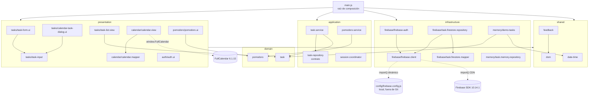

# Dependencias

Grafo generado a partir de los `import` reales (no de las referencias JSDoc). Sin ciclos: lo comprueba `tests/unit/architecture.test.js`, que también falla si alguna capa importa algo que no le corresponde.

## Entre capas

## Tabla (quién importa a quién)

| Módulo | Importa |
|---|---|
| `domain/task.js`, `domain/pomodoro.js` | — |
| `application/task.service.js` | `domain/task`, `application/task-repository` |
| `application/pomodoro.service.js` | `domain/pomodoro` |
| `application/session.coordinator.js`, `task-repository.js` | — |
| `infrastructure/firebase/firebase.client.js` | — (dinámicos: `config/firebase.config.js`, SDK por CDN) |
| `infrastructure/firebase/firebase-auth.js` | `firebase.client` |
| `infrastructure/firebase/task.firestore.repository.js` | `firebase.client`, `task.firestore.mapper` |
| `infrastructure/firebase/task.firestore.mapper.js` | — |
| `infrastructure/memory/task.memory.repository.js` | — |
| `infrastructure/memory/demo-tasks.js` | `domain/task`, `shared/date-time` |
| `presentation/tasks/task-input.js` | `shared/dom`, `shared/date-time` |
| `presentation/tasks/task-form.ui.js` | `shared/dom`, `shared/feedback`, `task-input` |
| `presentation/tasks/calendar-task-dialog.ui.js` | `shared/dom`, `shared/feedback`, `shared/date-time`, `task-input` |
| `presentation/tasks/task-list.view.js` | `shared/dom`, `shared/feedback`, `shared/date-time`, `domain/task` |
| `presentation/calendar/calendar.view.js` | `calendar.mapper` (+ `window.FullCalendar`) |
| `presentation/calendar/calendar.mapper.js` | `shared/date-time` |
| `presentation/pomodoro/pomodoro.ui.js` | `shared/dom`, `shared/date-time`, `domain/pomodoro` |
| `presentation/auth/auth.ui.js` | `shared/dom`, `shared/feedback` |
| `shared/feedback.js` | `shared/dom` |
| `shared/dom.js`, `shared/date-time.js` | — |
| `main.js` | todas las fábricas de presentación, aplicación e infraestructura; `shared/dom`, `shared/feedback` |

## Dependencias en tiempo de ejecución (inyectadas por `main.js`)

| Consumidor | Recibe |
|---|---|
| Vistas de tareas | `taskService` |
| `calendar.view.mount` | `onDateSelected` → `calendarDialog.open`; `onEventChanged` → `taskService.moveBlock` |
| `task.service` | un `TaskRepository` (memoria o Firestore) |
| `session.coordinator` | `auth`, `taskService`, fábricas de repositorio, callbacks de UI |
| `pomodoro.ui` | `pomodoroService` |
| `auth.ui` | `auth` |

## Externas

| Dependencia | Versión | Carga | Usada solo en |
|---|---|---|---|
| FullCalendar (paquete completo) | 6.1.15 | `<script>` jsDelivr en `index.html` | `presentation/calendar/calendar.view.js` |
| Firebase app/auth/firestore | 10.14.1 | `import()` de gstatic, bajo demanda | `infrastructure/firebase/firebase.client.js` |
| DM Sans | — | `@import` Google Fonts en `base.css` | estilos |
| jsdom, fullcalendar (npm) | 24.1.3, 6.1.15 | `devDependencies` | solo `tests/regression/` |

## Archivos fuera de la app
- `.agents/`, `skills-lock.json`: herramientas de agentes de IA del equipo; no forman parte de la app ni se publican.
- `.vscode/launch.json`: configuración personal con rutas de una máquina concreta.
